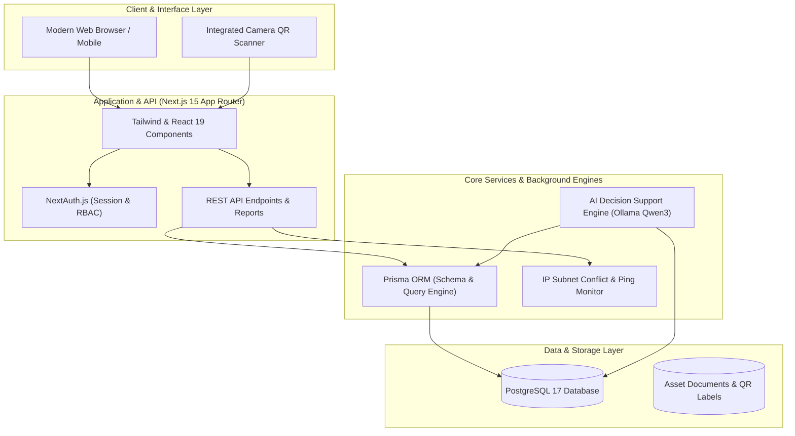

<div align="center">

# ⚡ ASCIT
### **Asset Care Information Technology System**
*Next-Generation Enterprise IT Asset & Lifecycle Management System with Local AI Decision Support*

[](https://github.com/mhmdhabibrafi/ASCIT/releases)
[](https://nextjs.org/)
[](https://www.typescriptlang.org/)
[](https://www.postgresql.org/)
[](https://www.prisma.io/)
[](https://tailwindcss.com/)
[](./LICENSE)

<br/>

[🌟 Repositori](https://github.com/mhmdhabibrafi/ASCIT) • [🐛 Laporkan Bug (Issues)](https://github.com/mhmdhabibrafi/ASCIT/issues) • [📖 Panduan Docker](./INSTALL-DOCKER-UBUNTU.md) • [📜 Lisensi](./LICENSE)

</div>

---

## 📌 Ringkasan Sistem

**ASCIT (Asset Care Information Technology System)** adalah platform perangkat lunak manajemen inventaris, siklus pakai (*lifecycle*), pemeliharaan (*maintenance*), mutasi, dan pengawasan alokasi jaringan (IP Address) aset IT kelas enterprise.

Sistem ini dirancang dan dikembangkan secara mandiri oleh **Muhammad Habib Rafi** dengan arsitektur modern berbasis Next.js App Router, PostgreSQL, serta dukungan modul kecerdasan buatan (*AI Decision Support*) lokal melalui Ollama untuk evaluasi depresiasi dan rekomendasi peremajaan perangkat secara otomatis.

---

## 🏗️ Arsitektur Sistem



---

## 🌟 Fitur Utama

| Modul | Deskripsi & Keunggulan |
| :--- | :--- |
| 📊 **Executive Dashboard** | Statistik real-time total aset, klasifikasi status kondisi (Baik, Rusak Ringan, Rusak Berat, Layak Ganti), metrik pengeluaran servis, dan grafik distribusi per unit. |
| 🖥️ **Manajemen Aset IT & Vendor** | Inventarisasi lengkap perangkat (PC, Laptop, Server, Switch, Printer, CCTV, UPS, Kiosk). Pemisahan data aset internal rumah sakit dan aset vendor sewa. |
| 🏷️ **QR Code Auto-Generator** | Setiap aset otomatis memiliki kode QR unik terenkripsi untuk pencetakan label fisik, memudahkan audit inventaris dan inventarisasi cepat di lapangan. |
| 🔄 **Pelacakan Mutasi Terpusat** | Rekam jejak mutasi antar-unit, antar-ruangan, dan serah terima penanggung jawab aset dengan histori kronologis yang transparan. |
| 🛠️ **Service Records & Maintenance** | Dokumentasi perawatan preventif berkala dan perbaikan korektif, pencatatan suku cadang pengganti (*spare parts*), teknisi, dan estimasi biaya perbaikan. |
| 🤖 **AI Decision Support** | Analisis beban kerja dan siklus pakai perangkat IT untuk memberikan rekomendasi otomatis: *Upgrade RAM/SSD*, *Maintenance Berkala*, atau *Prioritas Penggantian*. |
| 🌐 **Monitoring IP & Jaringan** | Pemetaan alokasi alamat IP jaringan static/DHCP per subnet, audit duplikasi IP (*IP collision detection*), dan monitoring ketersediaan host. |
| 🛡️ **Role-Based Access & Audit Trail** | Pembagian hak akses granular (*Super Admin*, *Admin IT*, *Staff IT*, *Kepala IT*, *Manajemen*) serta pencatatan seluruh mutasi data ke dalam log audit tak terhapus. |

---

## 💻 Tech Stack & Ketergantungan

* **Frontend Framework**: [Next.js 15.5](https://nextjs.org/) (React 19, Turbopack)
* **Bahasa**: [TypeScript 5](https://www.typescriptlang.org/)
* **Gaya Antarmuka**: [Tailwind CSS](https://tailwindcss.com/) & Vanilla CSS Design Tokens
* **Basis Data**: [PostgreSQL 17](https://www.postgresql.org/)
* **ORM**: [Prisma Client v6](https://www.prisma.io/)
* **Autentikasi**: [NextAuth.js v4](https://next-auth.js.org/)
* **Ekspor & Utilitas**: ExcelJS (Laporan Spreadsheet), QRCode, ZXing Barcode Scanner
* **AI Model Runner**: [Ollama](https://ollama.ai/) (Qwen3 LLM)
* **Containerization**: [Docker](https://www.docker.com/) & Docker Compose

---

## 📁 Struktur Direktori

```text
ascit/
├── prisma/
│   ├── schema.prisma           # Skema database relasional Prisma
│   ├── seed.ts                 # Script seeding data dummy simulasi
│   └── migrations/             # Riwayat migrasi skema database
├── public/                     # Aset visual statis publik & logo
├── scripts/
│   ├── local.mjs               # Otomasi runner database & aplikasi lokal
│   ├── local-config.mjs        # Konfigurasi koneksi PostgreSQL lokal
│   ├── ai-worker.ts            # Background worker analisis AI
│   └── db-health.mjs           # Script validasi kesehatan database
├── src/
│   ├── app/                    # Next.js App Router (Rute halaman & REST API)
│   │   ├── dashboard/          # Dashboard operasional eksekutif
│   │   ├── assets/             # Inventaris aset IT
│   │   ├── vendor-assets/      # Inventaris aset vendor
│   │   ├── mutations/          # Modul mutasi aset
│   │   ├── service-records/    # Riwayat servis & pemeliharaan
│   │   ├── monitoring/         # Pemantauan IP Address & Jaringan
│   │   ├── recommendations/    # AI Decision Support
│   │   ├── master-data/        # Referensi master data institusi
│   │   ├── users/              # Manajemen pengguna & permissions
│   │   ├── audit-log/          # Audit trail aktivitas pengguna
│   │   └── settings/           # Pengaturan konfigurasi & backup
│   ├── components/             # Reusable UI & Layout Components
│   └── lib/                    # Helper logic, prisma client, auth, rbac
├── docker-compose.yml          # Konfigurasi container Docker produksi
├── Dockerfile                  # Multi-stage production container build
├── INSTALL-DOCKER-UBUNTU.md     # SOP instalasi Docker di Ubuntu Server
├── LICENSE                     # Lisensi kepemilikan eksklusif
└── README.md                   # Dokumentasi utama proyek
```

---

## 🚀 Panduan Menjalankan Sistem

### 1. Menjalankan di Komputer Lokal (Tanpa Docker)

ASCIT dilengkapi dengan script otomasi `local.mjs` yang dapat mengelola database PostgreSQL lokal bawaan secara mandiri:

1. **Clone Repositori**:
   ```bash
   git clone https://github.com/mhmdhabibrafi/ASCIT.git
   cd ASCIT
   ```

2. **Install Dependensi**:
   ```bash
   npm install
   ```

3. **Siapkan File Lingkungan (`.env`)**:
   ```bash
   cp .env.example .env
   ```

4. **Inisialisasi Database & Seeding**:
   ```bash
   npm run db:setup
   ```

5. **Mulai Dev Server**:
   ```bash
   npm run dev
   ```
   Buka browser di: **`http://localhost:3000`**

---

### 2. Menjalankan di Server Produksi (Docker & Ubuntu)

Untuk deployment menggunakan container Docker pada Ubuntu Server:

1. Baca panduan langkah demi langkah pada **[INSTALL-DOCKER-UBUNTU.md](./INSTALL-DOCKER-UBUNTU.md)**.
2. Jalankan container:
   ```bash
   docker compose up -d --build
   ```
3. Cek status:
   ```bash
   docker compose ps
   ```

---

## 🔑 Akun Demo Pengujian (Data Sintetis / Dummy)

Saat database di-*seed* menggunakan script seeding (`prisma/seed.ts`), sistem menyiapkan akun dummy berikut untuk keperluan evaluasi lokal:

| Role | Username / Email | Password Default | Hak Akses |
| :--- | :--- | :--- | :--- |
| **Admin IT** | `admin` / `admin@ascit.local` | `DemoPassword123` | Akses penuh operasional IT & Master Data |
| **Staff IT** | `staf` / `staf@ascit.local` | `DemoPassword123` | Input servis, scan QR & pengajuan mutasi |
| **Kepala IT** | `kepala` / `kepala@ascit.local` | `DemoPassword123` | Approval mutasi & evaluasi rekomendasi AI |
| **Manajemen**| `manajemen` / `manajemen@ascit.local` | `DemoPassword123` | Laporan eksekutif & monitoring aset |

> **PERHATIAN KEAMANAN**: 
> Seluruh data awal repository (perangkat dummy, nomor seri dummy, alamat IP `10.99.x.x`, dan akun di atas) adalah **100% data tiruan sintetis** untuk tujuan pengujian. Untuk server produksi, definisikan kredensial yang aman melalui file `.env`.

---

## 👤 Pengembang & Hak Cipta

* **Pencipta & Pengembang**: **Muhammad Habib Rafi**
* **GitHub Profile**: [@mhmdhabibrafi](https://github.com/mhmdhabibrafi)
* **Repositori Resmi**: [https://github.com/mhmdhabibrafi/ASCIT](https://github.com/mhmdhabibrafi/ASCIT)

---

## 📞 Bantuan & Pelaporan Bug

Jika Anda menemukan kendala teknis atau permohonan pengembangan fitur:
* Silakan buat tiket kendala melalui **[GitHub Issues](https://github.com/mhmdhabibrafi/ASCIT/issues)**.

---

## 📜 Lisensi

Sistem ini dilindungi oleh **Proprietary & All Rights Reserved License**. Dilarang memperbanyak, mendistribusikan ulang, menjual kembali, atau menghapus atribusi pencipta tanpa izin tertulis resmi dari pembuat hak cipta. Lihat detail lengkap pada file **[LICENSE](./LICENSE)**.

<div align="center">
  <sub>Copyright © 2026 <b>Muhammad Habib Rafi</b>. All rights reserved.</sub>
</div>
